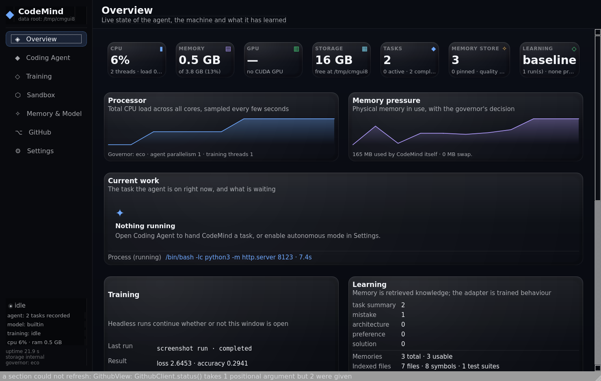

# CodeMind

A local, autonomous coding assistant with a native Ubuntu desktop application.
No cloud inference, no paid APIs: everything — the agent, the memory, the training — runs on your
own machine.



```bash
python3 main.py
```

That is the whole launch procedure once the dependencies are installed (see below). CodeMind opens
a native Qt window, not a browser tab.

---

## What it does

| Area | Reality |
| --- | --- |
| **Coding agent** | Inspects a repository before touching it, plans multi-step work, edits files, runs shell/Python/Git/tests, reads the output, diagnoses failures, repairs and retries, then verifies and reports. Tasks survive restarts and can be queued, cancelled, paused and resumed. |
| **Memory** | Persistent SQLite + FTS5 knowledge across sessions: architecture notes, preferences, verified solutions, past mistakes, task summaries. Retrieved into every plan. Memory is *not* training and is kept separate from it. |
| **Training** | Real, headless fine-tuning of a local model: QLoRA/LoRA when the toolchain and GPU allow it, plus a lightweight adapter and a retrieval index that work everywhere. Datasets are validated, configs are reproducible, checkpoints and metrics are stored, and a candidate is promoted only after it measurably beats the baseline. |
| **Sandbox** | Isolated workspaces per task, command timeouts, rlimits/cgroup accounting, process trees, blocked destructive patterns, configurable network access and an execution history. |
| **GitHub** | Clone, branch, commit, diff, push, pull requests and CI checks through the `gh` CLI or a token, with credentials redacted from every log line and payload. |
| **Storage** | Internal SSD for active work, an optional USB drive (auto-detected, never hardcoded) for projects, datasets, checkpoints and logs. Works normally when the drive is absent. |

## Requirements

- Ubuntu 22.04+ (any modern Linux with Qt6 works), Python 3.10 or newer
- A desktop session for the GUI; the agent, training and CLI work headless
- Hardware is detected at start-up and everything is scaled to it — an 8 GB GPU is used for
  training, a 2-core laptop still gets a working agent with the built-in deterministic planner

## Install

```bash
cd /path/to/AgentOS

# a virtual environment is not required, but keeps PySide6 out of your system Python
python3 -m venv .venv
. .venv/bin/activate
pip install -r requirements.txt

# verify the installation: hardware, inference, tools, sandbox, storage, GitHub
python3 main.py --check
```

`main.py` re-executes itself with `./.venv/bin/python` when the current interpreter has no
PySide6, so `python3 main.py` works from a checkout that ships its own virtualenv.

If the distribution packages Qt instead of pip:

```bash
sudo apt install python3-pyside6.qtwidgets
```

Optional packages for LoRA/QLoRA training (see `requirements.txt` for the exact commands) unlock the
two heavyweight methods; without them the Training view stays honest and says so.

### Desktop entry (optional)

The shipped `assets/codemind.desktop` expects the checkout at `/opt/codemind`; adjust `Exec` and
`Icon` if you keep it elsewhere.

```bash
mkdir -p ~/.local/share/applications
sed "s#/opt/codemind#$(pwd)#g" assets/codemind.desktop > ~/.local/share/applications/codemind.desktop
update-desktop-database ~/.local/share/applications 2>/dev/null || true
```

## Using it

```bash
python3 main.py                                  # the desktop application
python3 main.py --check                          # self-test, human readable
python3 main.py --doctor                         # the same, as JSON
python3 main.py --task "Add tests for the parser" --project ~/code/project
python3 main.py --task "Fix the failing build" --mode autonomous --project ~/code/project
python3 main.py --train --name night-1 --method auto --install-seed --evaluate --promote
python3 main.py --headless                       # agent without any interface
```

`--task` exits `0` only when the task really finished (`completed`); a blocked or failed task exits
non-zero and prints why. `--data-root <dir>` (or `CODEMIND_DATA_DIR`) moves all state — database,
logs, datasets, models — for a portable installation or a USB drive.

### The seven views

1. **Overview** — machine and agent state, current work, resource history, learning progress,
   autonomy proposals.
2. **Coding Agent** — submit a task, watch the plan and each step, live tool activity, diffs,
   test output, approvals, cancel/pause/resume.
3. **Training** — datasets, methods and what is missing, start/cancel/pause runs, live loss and
   throughput, checkpoints, evaluation results, promotion and model comparison.
4. **Sandbox** — workspaces, running processes, execution history, per-command limits and the
   command policy that is actually enforced.
5. **Memory & Models** — memories with search/pin/prune, indexed project knowledge, the local model
   catalogue with fit notes for your hardware, downloads.
6. **GitHub** — credentials, repositories, branches, commits, diffs, push, pull requests, checks.
7. **Settings** — model paths, storage (including the USB drive), resources, network, autonomy,
   permissions, logging. Every value is validated before it is accepted.

## Permissions

Routine, reversible work (reading, searching, running tests, editing files inside the task
workspace) needs no confirmation. Approval is requested for destructive commands, anything that
touches credentials, and irreversible external actions such as pushing. One of four profiles —
`manual`, `supervised`, `trusted`, `autonomous` — sets how far the agent may go on its own;
autonomous mode is restricted to maintenance, bug fixing, test improvements, repository analysis and
experiments, with a daily time budget.

Secrets are scrubbed on the way out: command output, tool results, GitHub payloads and every log
record pass through the redactor before they are written. Child processes do not inherit your
tokens.

## Training, honestly

- **QLoRA / LoRA** — real fine-tuning of a local coding model, used when an NVIDIA GPU with CUDA,
  `torch`, `transformers`, `peft` and `bitsandbytes` are present.
- **adapter_lite** — a small trained classifier over the tool-selection task that runs on any CPU
  and is genuinely evaluated (it decides which tool a request needs).
- **retrieval_index** — embeds project knowledge for retrieval; no gradients, instant, useful.
- Datasets come from the curated starter set, from your imported JSONL/JSON/CSV, or from your own
  completed and verified tasks (quality-gated; a failed task never becomes training data).
- Evaluation runs the candidate *and* the untouched baseline over the same benchmark suite, and
  compares the scores. Promotion requires a real improvement (`training.promote_min_gain`) and no
  regressions; otherwise the candidate is only recorded.

## Tests

```bash
python3 -m unittest discover -s tests -t .          # everything that can run here
./.venv/bin/python -m unittest discover -s tests -t .   # includes the GUI and launcher tests
```

| Module | What it proves |
| --- | --- |
| `tests/test_structure.py` | no shadowed definitions, no hardcoded machine paths, no stubs, every module imports, no cloud inference endpoints |
| `tests/test_core.py` | storage and database integrity, memory search, settings validation and persistence, hardware probe, resource governor, sandbox execution and policy |
| `tests/test_agent.py` | tool inventory, permission classification, real repository analysis, a full run with verification evidence, the diagnose→repair→retry loop, cancellation, restart survival, no invented code |
| `tests/test_training.py` | curated starter set without benchmark leakage, dataset import/export, training a real adapter, evaluation against the baseline, promotion, rejection, persistence across restarts |
| `tests/test_utils.py` | text/file helpers, command timeouts and process control, credential redaction down to the log file, configuration validation |
| `tests/test_ui.py` | the launcher CLI (`--version`, `--check`, `--doctor`, `--task`) and all seven views refreshing against a real application |

The suite is deliberately lightweight: it needs no GPU, no model download and runs in about a
minute on two cores. The GUI tests skip themselves when Qt cannot open a display.

## Layout

```
main.py                     launcher: GUI, --check/--doctor/--task/--train/--headless
codemind/
  app.py                    composition root, wiring, health
  agent/                    planner, executor, permissions, tool registry, task store, runner
  autonomy/                 scheduled maintenance sessions and proposals
  llm/                      local backends (llama.cpp, Ollama) + deterministic planner
  memory/                   memories, knowledge index, retrieval
  sandbox/                  workspaces, limits, command policy, history
  training/                 datasets, methods, engine, evaluator, worker, seed set
  github/                   git and GitHub operations, credentials, redaction
  storage/                  database, storage layout, USB detection
  system/                   hardware probe, resources, governor
  ui/                       theme, widgets, seven views, main window
tests/                      the suite described above
tools/                      headless screenshot harness, icon renderer
assets/                     icon and screenshots
docs/                       architecture notes; AGENTOS_LEGACY_* is the previous web prototype
```

## Troubleshooting

| Symptom | Fix |
| --- | --- |
| `libGL.so.1: cannot open shared object file` | install the GL runtime: `sudo apt install libgl1 libegl1` |
| `No module named 'PySide6'` | `pip install -r requirements.txt` inside `.venv`, or use the apt package; the launcher will find `./.venv` by itself |
| `qlora unavailable: NVIDIA GPU with CUDA` | that is the truthful answer — install the CUDA stack from `requirements.txt`, or use `adapter_lite` |
| Headless machine (SSH, no display) | run `python3 main.py --task ...` or `--train`; the interface is optional |
| The agent refuses a command | it matched a blocked pattern or needs approval; see Settings → Permissions and the policy listing in the Sandbox view |

## Previous prototype

This repository started as **AgentOS**, a TypeScript/React web dashboard. It is preserved for
reference in `src/`, `server/`, `shared/` and `docs/AGENTOS_LEGACY_*.md`, and is not part of the
product: CodeMind is a native desktop application written in Python.
